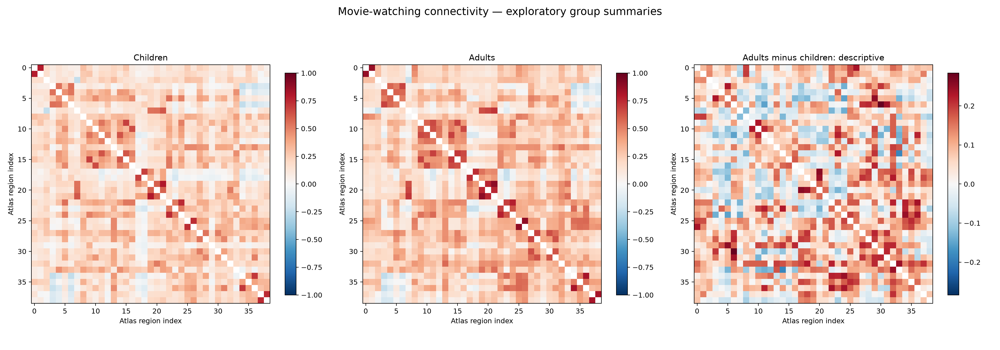
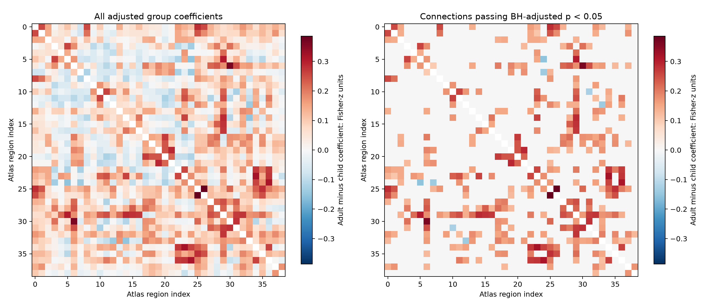
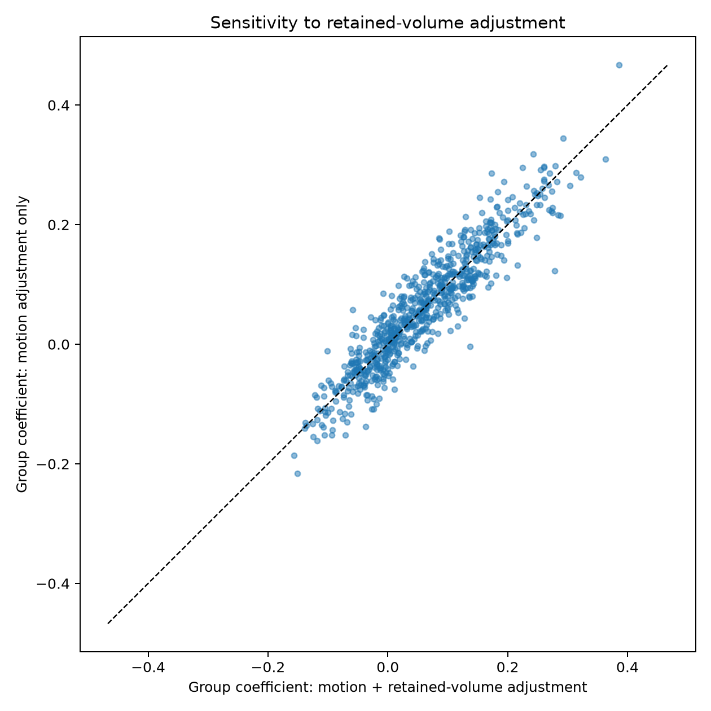

# Open Brain Explorer

An exploratory Python project visualizing functional brain connectivity
during movie watching in children and adults.

The project combines motion quality checks, regional signal extraction,
interactive 3D networks, and exploratory group comparisons.

## Interactive explorer

Download `docs/index.html` and open it in a web browser.

The explorer supports:
- Rotating and zooming the network.
- Filtering connections by BH-adjusted p-value.
- Filtering by coefficient magnitude and direction.
- Viewing connection coefficients and pointwise confidence intervals.

Node positions represent atlas-region coordinates. Edges represent
statistical associations, not anatomical tracts.

## Data

Original study: OpenNeuro dataset ds000228.

https://openneuro.org/datasets/ds000228

This project uses the preprocessed, 4 mm downsampled dataset distributed
through Nilearn's `fetch_development_fmri` function, rather than the
complete raw OpenNeuro archive.

https://nilearn.github.io/stable/modules/generated/nilearn.datasets.fetch_development_fmri.html

Downloaded sample:
- 122 children.
- 33 adults.
- 155 participants in total.

Raw and downloaded imaging data are not included in this repository.

## Analysis workflow

1. Download and inspect the data.
2. Summarize framewise displacement (FD).
3. Extract signals using the 39-region MSDL atlas.
4. Censor volumes with FD above 0.5 mm or missing FD.
5. Censor supplied non-steady-state flags when present.
6. Require at least 120 retained volumes.
7. Regress six motion parameters, CSF, white-matter signals, and
   supplied cosine terms, with linear detrending.
8. Calculate regional Pearson correlations.
9. Transform correlations to Fisher-z values for group analysis.
10. Fit connection-wise linear models with adult/child group,
    retained mean FD, and retained-volume count.
11. Use HC3 robust standard errors and Benjamini–Hochberg correction
    across 741 unique connections.

No additional spatial smoothing, additional temporal filter, or
global-signal regression was applied in the full-sample pipeline.

The motion threshold and minimum-volume requirement are exploratory
project settings, not universal quality standards.

## Sample retention

| Group | Downloaded | Retained | Excluded |
|---|---:|---:|---:|
| Children | 122 | 103 | 19 |
| Adults | 33 | 32 | 1 |
| Total | 155 | 135 | 20 |

Exclusions were due to insufficient retained volumes under the
specified censoring rules.

Mean FD among retained volumes:
- Adults: approximately 0.160 mm.
- Children: approximately 0.164 mm.

## Exploratory results

Under the specified adjusted model:
- 741 unique connections were tested.
- 180 passed BH-adjusted p < 0.05.
- 176 had positive adult-minus-child coefficients.
- 4 had negative coefficients.

Positive coefficients indicate higher adjusted Fisher-z connectivity
in adults. They do not indicate better brain function.

These results describe associations in the retained sample and do
not establish developmental or causal effects.

## Sensitivity checks

### Equal-volume subsampling

Connectivity was recalculated using 120 retained observations per
participant, with 50 reproducible selections.

The correlation between the all-retained and average subsampled
group-difference patterns rounded to 1.000.

This check reused already-cleaned signals. It does not equalize
effective information, temporal coverage, or residual motion.

### Model and participant sensitivity

- The coefficient-pattern correlation between models with and
  without retained-volume adjustment was 0.9316.
- None of the 180 initially BH-selected connections changed
  coefficient direction in leave-one-participant-out checks.
- The largest absolute leave-one-out coefficient change across
  all connections was approximately 0.0411 Fisher-z units.

Leave-one-out direction stability does not establish stability
of statistical significance.

## Figures







## Limitations

- This is an exploratory learning and portfolio project.
- The data are cross-sectional and collected during movie watching.
- Children and adults occupy separate age ranges.
- More children than adults were excluded.
- Residual motion and selection effects may remain.
- Motion censoring produces different temporal coverage between people.
- The adjusted model does not include sex or all possible confounders.
- Statistical inference assumes independent participants.
- Confidence intervals are pointwise, not multiplicity-adjusted.
- Broad image-quality review and alternative cleaning analyses remain
  incomplete.
- Display filtering does not recalculate multiple-testing corrections.

## Repository structure

- `scripts/`: download, quality-control, analysis, and visualization code.
- `figures/`: selected figures.
- `docs/index.html`: interactive results explorer.
- `requirements.txt`: package versions from the working environment.
- `.gitignore`: exclusions for downloaded data and local environments.

## Environment setup

Developed using Python 3.13 on Windows.

From the repository root:

```bat
py -3.13 -m venv .venv
.venv\Scripts\python.exe -m pip install -r requirements.txt
```

The scripts are numbered in workflow order.

**Current setup note:** the script copies still require path updates
before they can be run from this repository. Their original working
versions were executed from the Downloads folder. A clean
repository-based rerun has not yet been verified.

## Data and software acknowledgements

Please cite the original study by Richardson and colleagues,
“Development of the social brain from age three to twelve years,”
as requested in the Nilearn dataset documentation.

Additional resources:
- Nilearn: https://nilearn.github.io/
- MSDL atlas documentation:
  https://nilearn.github.io/stable/modules/generated/nilearn.datasets.fetch_atlas_msdl.html
- Plotly: https://plotly.com/python/
- Statsmodels: https://www.statsmodels.org/

Dataset and atlas licences and complete citation details should be
verified before public release. Third-party data and software retain
their own licence terms.

## Author

Hitha Krishna Chirakundil Ramakrishnan